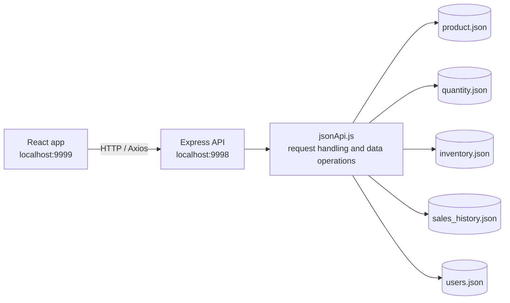

# Product Sales Information System

A small product sales and inventory application with a React frontend and an Express backend. The active backend stores data in JSON files, so it can run without a database server.

## Features

- **Dashboard** — current-month revenue and gross profit, sales by product, inventory summary, and shortcuts to the main workflows.
- **Sales entry** — enter quantities by product. Saving adds to the product's cumulative quantity and records a dated sales-history entry with the prices in effect at the time of sale.
- **Revenue and profit** — review monthly revenue, gross profit, margin, month-over-month changes, daily revenue, low-margin products, and export product totals as CSV.
- **Product management** — search products, add products, edit purchase and sale prices, and delete selected products.
- **Inventory** — review stock levels, identify low or out-of-stock products, and add incoming stock.
- **Sign-in** — verify the demo user's credentials against a locally stored password hash.

## Architecture



The frontend uses the API routes listed below. `express/server.js` connects those routes to `express/jsonApi.js`. The JSON files under `express/data/` are the active source of truth; the server does not open a database connection.

## Data files

| File | Purpose | Main fields |
| --- | --- | --- |
| `express/data/product.json` | Product catalog and current prices | `prod_cd`, `pur_price`, `sale_price` |
| `express/data/quantity.json` | Cumulative sales quantity and most recent entry date | `prod_cd`, `sale_cnt`, `sale_date` |
| `express/data/inventory.json` | Current stock by product | `prod_cd`, `invt_cnt` |
| `express/data/sales_history.json` | Dated sales entries and price snapshots used for profit reports | `id`, `prod_cd`, `sale_date`, `sale_cnt`, `pur_price`, `sale_price` |
| `express/data/users.json` | Sign-in usernames and salted password hashes | `username`, `salt`, `password_hash` |

Demo product, inventory, and sales-history records are included. Sales history includes sample records for October and November 2026 so the monthly reports and comparisons have data to display.

## API routes

The frontend's existing route paths and payloads are retained. The sign-in route is an addition; the product, sales, profit, and inventory routes continue to serve their existing workflows.

| Method | Route | Purpose |
| --- | --- | --- |
| `POST` | `/api/login/` | Validate a username and password |
| `GET` | `/api/srchProduct/` | List products and prices |
| `POST` | `/api/addProduct/` | Add a product and initialize its quantity and inventory records |
| `PUT` | `/api/updateProduct/` | Update a product price |
| `DELETE` | `/api/delProduct/:id` | Delete product, current quantity, and inventory records; retain sales history |
| `GET` | `/api/srchQuantity/` | List sales quantities with product prices |
| `PUT` | `/api/updateQuantity/` | Add a sales quantity and append a sales-history entry |
| `GET` | `/api/srchProfit/:dt` | Summarize sales history for a `YYYY-MM` month |
| `GET` | `/api/srchProfitDaily/:dt` | Summarize daily sales history for a `YYYY-MM` month |
| `GET` | `/api/srchInventory/` | List current inventory with product information |
| `PUT` | `/api/updateInventory/` | Add incoming units to current inventory |

## Run locally

Use a recent Node.js LTS release. Install dependencies in both application folders, then run the backend and frontend in separate terminals.

### Express backend

```bash
cd express
npm install
node server.js
```

The API listens on `http://localhost:9998` by default. Set the `port` environment variable to use a different port.

### React frontend

```bash
cd react
npm install
npm start
```

The frontend runs on `http://localhost:9999`. Its API base URL is currently set in `react/src/config.js` to `http://localhost:9998`. Change that value when the API is hosted elsewhere. On Windows, `server.bat` and `client.bat` start the backend and frontend respectively.

### Demo sign-in

- Username: `user1`
- Password: `1234`

The password is stored as a salted scrypt hash in `express/data/users.json`; the plaintext demo password is not stored in that file.

## Data behavior

- Sales entry adds units to `quantity.json` and appends a separate row to `sales_history.json`.
- Profit and daily-trend reports are calculated from `sales_history.json` and use the price snapshots saved with each sale.
- Incoming inventory adds units to `inventory.json`.
- Editing a product's current price does not change prices already captured in sales history.
- Deleting a product removes its current product, quantity, and inventory records. Historical sales remain available to reports.
- Writes to each individual JSON file use a temporary file followed by a rename. Mutations are queued within one running Node.js process.

## Using it in a real environment

This setup is intended for demos, local evaluation, or a small single-server deployment. Before using it for live business data:

1. **Replace the demo credentials.** Use managed user accounts, strong password policies, login throttling, session or token management, and authorization checks. The current login route verifies credentials, but the React routes are not protected by a persistent authenticated session.
2. **Protect the service.** Serve the app over HTTPS, restrict CORS to the approved frontend origin, validate and limit request sizes, and keep the JSON directory and backups readable only by the service account.
3. **Plan for persistence and recovery.** Keep `express/data/` on durable storage, schedule backups, and test restoring a backup. Editing JSON files manually while the server is running can overwrite concurrent changes.
4. **Keep one backend instance.** The in-process write queue coordinates mutations only inside one Node.js process. Multiple instances, multiple hosts, or concurrent external file edits can cause lost updates. For those workloads, use a database or a storage service with transactions and concurrency control.
5. **Configure environments separately.** Move the frontend API base URL to environment-specific configuration and run the React production build behind a web server or reverse proxy. Do not expose demo accounts or sample business data in a public deployment.
6. **Check historical coverage.** The included October–November 2026 sales records are demo data. New daily and monthly reports reflect entries recorded in `sales_history.json`; past dates cannot be reconstructed from cumulative quantities alone.

## Extending the system

The frontend and backend are separated by stable HTTP routes, and the active data is organized by business entity. This makes it possible to add workflows incrementally while keeping existing screens and API contracts intact. For example, a returns feature could add a returns data model, its own routes, and a React screen. A repository layer can later replace JSON persistence with SQL or another store behind the same routes, allowing the user interface to remain unchanged.

As usage grows, useful additions include role-based access, audit logs, stock adjustments and returns, configurable low-stock thresholds, and automated data backup and restore.
