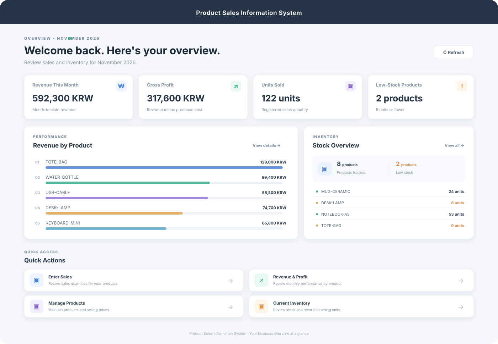

# Product Sales Information System

**A clear daily view of what you sell, what you earn, and what you need to restock.**

The Product Sales Information System is a lightweight management tool for small, product-based businesses. It brings product prices, sales quantities, revenue, gross profit, and on-hand stock into one straightforward workflow.

## Main dashboard

The dashboard gives owners and staff a quick operational snapshot: monthly revenue and gross profit, products sold, low-stock items, best-selling products, and shortcuts to common tasks.

The preview uses the included demo data for November 2026. The dashboard itself updates from the current data files when the application runs.

## Useful across different product businesses

The system is organized around products, prices, sales quantities, and stock rather than a specific industry. That makes it a practical starting point for businesses with a simple product catalog and a single stock total per item.

| Business type | Example use |
| --- | --- |
| Independent retail | Track products and prices, record daily sales, and spot items running low. |
| Online and social sellers | Keep a simple stock count and review monthly product revenue and gross profit. |
| Market stalls and pop-up shops | Enter sold quantities after a shift and add newly received stock. |
| Small wholesalers | Review product-level sales and maintain a basic stock list. |
| Makers and small brands | Track finished goods, selling prices, and incoming inventory. |
| Specialty and gift shops | Compare product revenue and identify items that may need replenishing. |
| Office or maintenance suppliers | Keep consumables and frequently sold supplies visible in one list. |

## A simple everyday workflow

1. **Review the dashboard** to see the month's sales and profit, current stock, and low-stock products.
2. **Record sales** by product. The entered quantity is added to the cumulative quantity and written to dated sales history.
3. **Record incoming stock** when products arrive. Incoming units are added to the current stock count.
4. **Maintain the catalog** by adding products or editing their purchase and sale prices.
5. **Review performance** by month, compare it with the previous month, inspect daily revenue and product margins, or export the product summary as CSV.

The pages use the same product codes, so a product added to the catalog is available in both sales and inventory workflows.

## What is included

- **Dashboard:** monthly revenue and gross profit, units sold, low-stock count, top products by revenue, and quick actions.
- **Sales entry:** product-level quantity entry with a pending total and a bulk save action.
- **Revenue and profit:** monthly product breakdown, previous-month comparison, daily revenue trend, configurable low-margin alert, and CSV export.
- **Product management:** product-code search, product creation, inline price editing, and selected-product deletion.
- **Inventory:** current stock summary, low-stock and out-of-stock indicators, product search, and incoming-stock entry.
- **Sign-in:** demo credential verification against a locally stored password hash.

## A flexible starting point

The workflow is split into product, sales, profit, inventory, and sign-in areas, with the frontend communicating through Express routes. This provides room to add business-specific features without tying the screens to one type of shop. Future additions could include product categories, barcode scanning, purchase receipts, returns, multiple stock locations, staff roles, and data import/export.

As the business grows, JSON persistence can be replaced with a database behind the existing route boundary. The current interface and workflows can then evolve independently from the storage layer.
